# SNARE: Rotating Hidden-Camera Scanner

SNARE sweeps a room for hidden cameras. A motor turns a sensor head through a full
360 degree rotation in 90 seconds while four ultrasonic range sensors and two thermal
IR arrays sample once a second. Readings in the heat band that powered camera
electronics give off (27 to 55 °C) are flagged as **Hidden Camera** or **Maybe Hidden
Camera**, placed on a radar plot by angle and distance, stamped with GPS time and
location, and stored encrypted on the device. A phone or laptop connects to the
scanner's own Wi-Fi to watch the live radar or download the results.

<p align="center">
  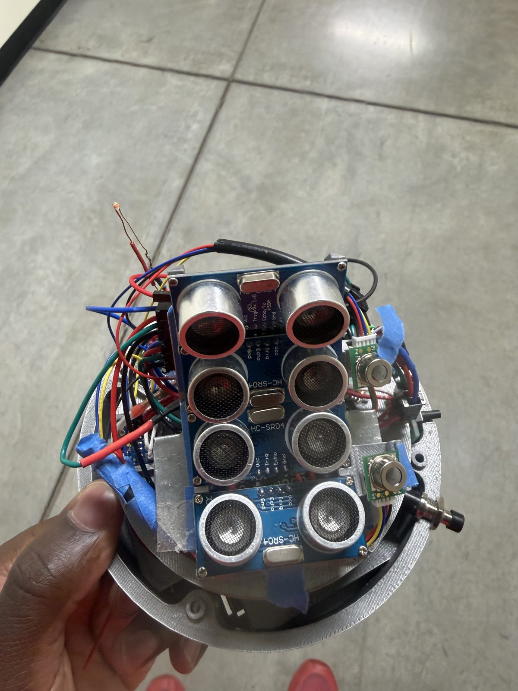
  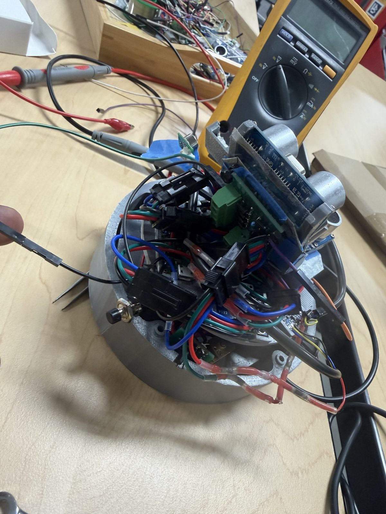
  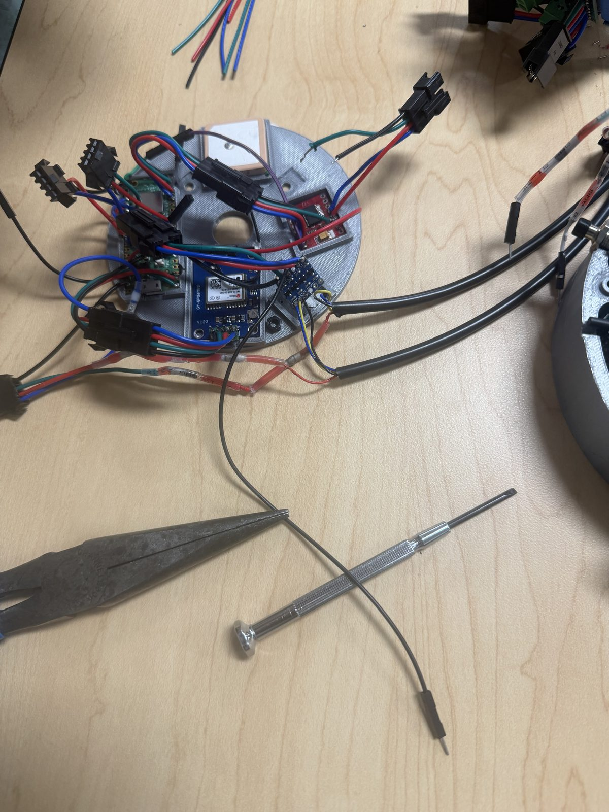
</p>

## Demo

Short loops sampled from the test videos. Click a loop for the full video.

<table>
  <tr>
    <td><a href="https://github.com/Charlesganu2004/snare-hidden-camera-scanner/releases/download/build-media/snare-motor-rotation-test.mov">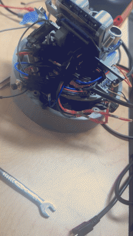</a></td>
    <td><a href="https://github.com/Charlesganu2004/snare-hidden-camera-scanner/releases/download/build-media/snare-powered-scan-rotation.mov">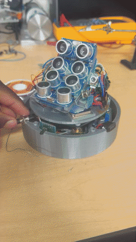</a></td>
    <td><a href="https://github.com/Charlesganu2004/snare-hidden-camera-scanner/releases/download/build-media/snare-final-assembly.mov">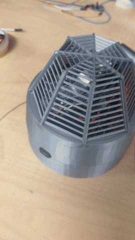</a></td>
  </tr>
  <tr>
    <td>Motor rotation test (31 s)</td>
    <td>Powered scan rotation (25 s)</td>
    <td>Final assembly, teammates' cover (37 s)</td>
  </tr>
</table>

More: [wiring walkaround (15 s)](https://github.com/Charlesganu2004/snare-hidden-camera-scanner/releases/download/build-media/snare-wiring-walkaround.mov)
and [electronics plate close-up (5 s)](https://github.com/Charlesganu2004/snare-hidden-camera-scanner/releases/download/build-media/snare-electronics-plate.mov).
All five videos are on the [build-media release](https://github.com/Charlesganu2004/snare-hidden-camera-scanner/releases/tag/build-media).

## My role

This was a team build. I was responsible for the electronics and the software:

| Area | What I did |
|---|---|
| Electrical design | Designed the circuit: assigned every Pico GPIO, laid out the hand-soldered perfboards and the JST wiring harness |
| Soldering and wiring | Soldered the Pico 2 W headers, the perfboards and the harness; wired every sensor into the stack |
| Firmware | Wrote the MicroPython firmware in this repository |
| Motor rotation testing | Brought up the TB6612FNG driver and tuned the 90 second scan rotation |
| Scanner data and processing | Sensor angle math, detection rules, radar plots, encrypted storage, Wi-Fi and USB export |

**Not my work:** the mechanical housing. Teammates designed the 3D-printed shell and
the base the scanner sits in.

## How it works

1. **Boot.** The Pico starts the scan loop on its own (`AUTO_SCAN_ON_BOOT`). The red LED
   stays solid while a scan runs; the green LED flashes when Wi-Fi connects and pulses
   while the setup portal is open.
2. **Rotate and sample.** The TB6612FNG drives the gear motor through one rotation in
   `ROTATION_TIME_SECONDS = 90`. Every second the firmware reads all four HC-SR04
   ultrasonic sensors and both Omron D6T-8L-09H thermal arrays.
3. **Locate.** Each sensor has a fixed angle offset from the forward scan line
   (`SENSOR_GEOMETRY` in `config.py`), so a reading becomes a point at
   `(rotation angle + offset, distance)`.
4. **Classify.** A thermal frame whose pixels all fall inside 27 to 55 °C is a
   **Hidden Camera** hit; a frame with only some pixels in that band is **Maybe Hidden
   Camera**. Hits are summarized per scan so a download is easy to read.
5. **Record.** Every scan gets a number, the GPS UTC time and position from the NEO-6M,
   and is encrypted before it is written to the Pico's flash.
6. **Share.** Hold the button to open the setup portal: the Pico becomes a Wi-Fi access
   point (`SNARE_Device_101`), serves a live radar page during a scan, and offers JSON
   and HTML radar-replay downloads. The same data can be pulled over USB serial.

### Button controls

| Press | Action |
|---|---|
| Click (under 5 s) | Start a scan |
| Hold 10 s | Open the Wi-Fi setup portal |
| Hold 30 s | Stop the device |

## Electrical design

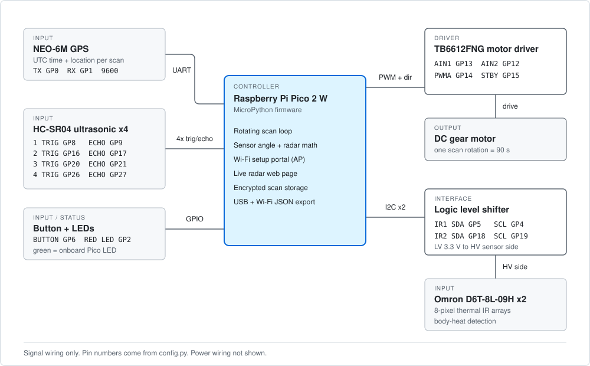

| Part | Signal | Pico 2 W pin |
|---|---|---|
| TB6612FNG motor driver | AIN1 / AIN2 / PWMA / STBY | GP13 / GP12 / GP14 / GP15 |
| HC-SR04 ultrasonic 1 | TRIG / ECHO | GP8 / GP9 |
| HC-SR04 ultrasonic 2 | TRIG / ECHO | GP16 / GP17 |
| HC-SR04 ultrasonic 3 | TRIG / ECHO | GP20 / GP21 |
| HC-SR04 ultrasonic 4 | TRIG / ECHO | GP26 / GP27 |
| Omron D6T-8L-09H thermal IR 1 | SDA / SCL (through level shifter) | GP5 / GP4 |
| Omron D6T-8L-09H thermal IR 2 | SDA / SCL (through level shifter) | GP18 / GP19 |
| NEO-6M GPS | UART0 TX / RX, 9600 baud | GP0 / GP1 |
| Momentary button | input | GP6 |
| Red status LED | output | GP2 |
| Green status LED | onboard LED | `"LED"` |

Design notes:

- **Pin conflict fixed.** Motor PWM first shared a pin with the second ultrasonic
  trigger. I moved PWM to GP14 so the trigger could stay on GP16.
- **Two I2C buses.** Both D6T arrays answer at the same I2C address, so each one gets
  its own software I2C bus instead of sharing one.
- **Level shifting.** The thermal arrays run on the high-voltage side of a
  bidirectional level shifter; the Pico's 3.3 V pins sit on the low side.
- **Serviceable harness.** Every sensor plugs into the stack through JST connectors,
  so the head can come apart without desoldering.

## Build photos

<table>
  <tr>
    <td>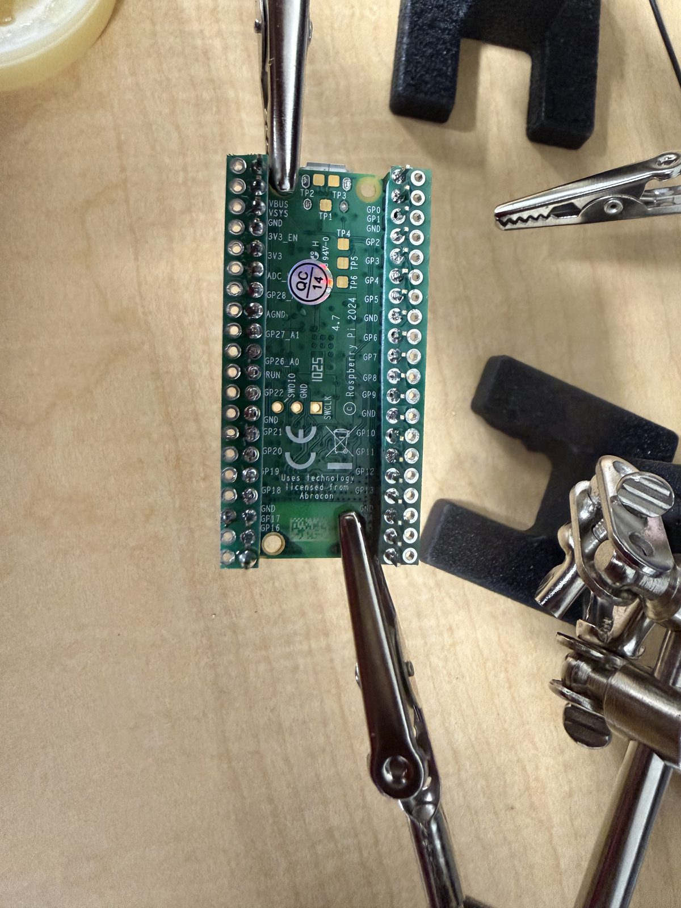</td>
    <td>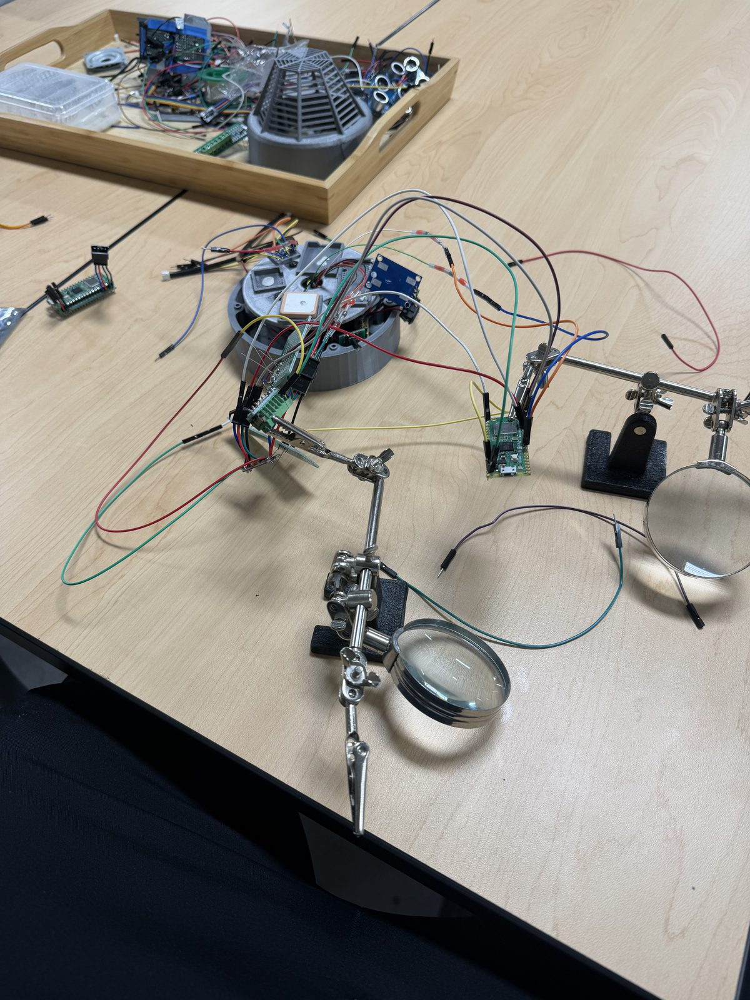</td>
    <td>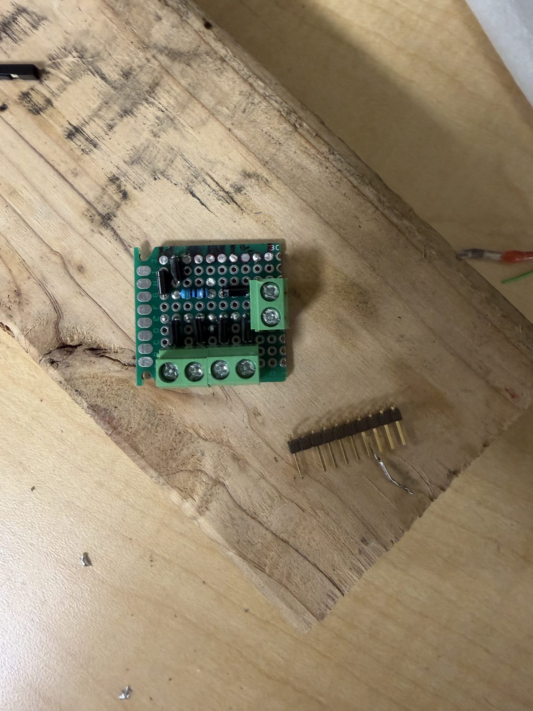</td>
  </tr>
  <tr>
    <td>Pico 2 W headers soldered</td>
    <td>Bench bring-up on jumpers</td>
    <td>Perfboard, second revision</td>
  </tr>
  <tr>
    <td>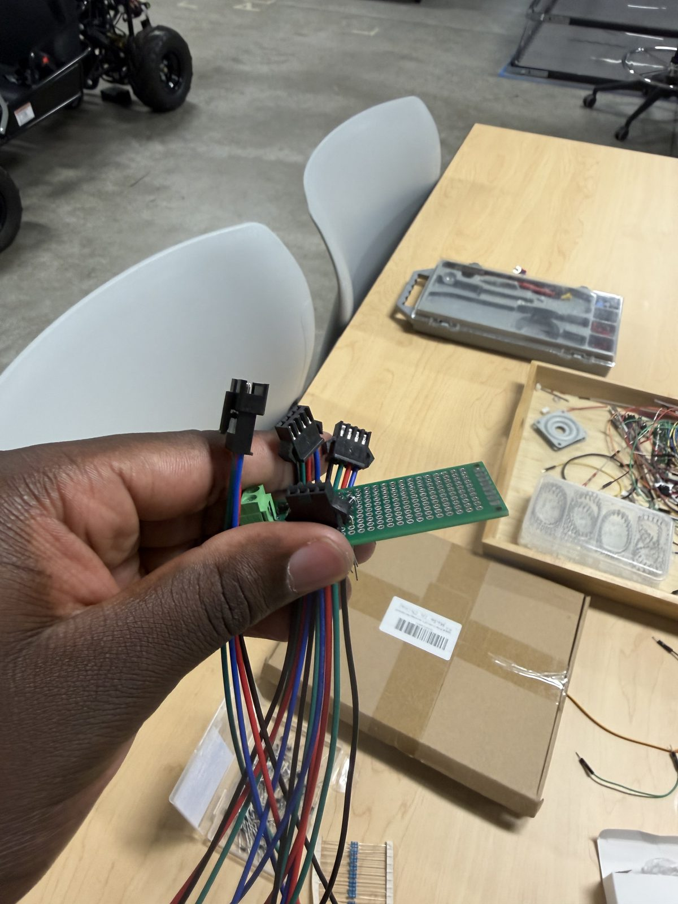</td>
    <td>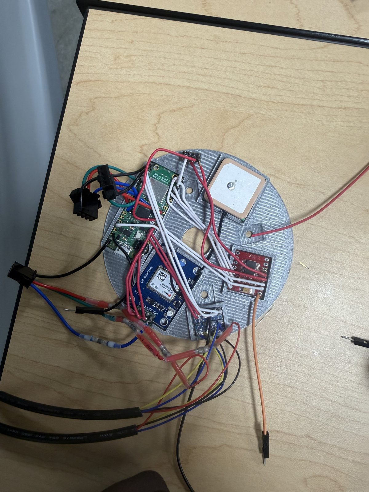</td>
    <td>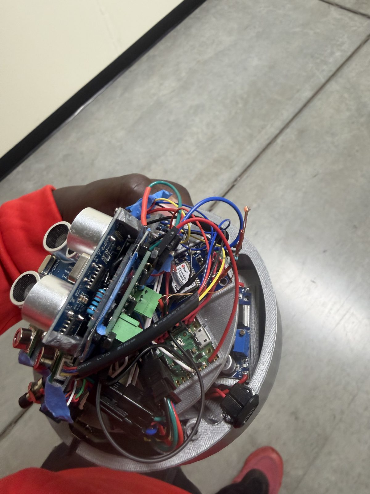</td>
  </tr>
  <tr>
    <td>JST wiring harness</td>
    <td>Electronics plate with GPS</td>
    <td>Assembled scanner</td>
  </tr>
</table>

All 23 build photos, in order, with captions: [docs/GALLERY.md](docs/GALLERY.md).

## Repository layout

```
main.py              scan loop, detection rules, button and LED handling
config.py            pin map, scan timing, sensor geometry, storage settings
Motor_Control.py     TB6612FNG driver
Ultrasonic.py        HC-SR04 ranging
IR_Sensor.py         Omron D6T-8L-09H thermal array reader
GPS.py               NEO-6M NMEA parsing (UTC time and position)
Storage.py           record storage on the Pico's flash
Crypto_Manager.py    encryption for stored scan records
Graph_Manager.py     radar plots: live page, HTML replay, terminal view
Wifi_manager.py      access point, setup portal, live radar server, USB serial commands
Bluetooth_manager.py Bluetooth LE advertising and device-info service during setup
Button.py            button input
boot.py              standalone boot message
docs/                wiring diagram and photo gallery
media/               build photos and demo loops
```

## Run it

1. Flash MicroPython for the Raspberry Pi Pico 2 W.
2. Copy every `.py` file in the repository root to the Pico (the MicroPico VS Code
   extension or `mpremote` both work).
3. Change `AP_PASSWORD` and `STORAGE_SECRET` in `config.py` before you deploy. The
   values in this repository are development defaults.
4. Power the board. With `AUTO_SCAN_ON_BOOT = True` the first scan starts on its own.
5. Over USB serial, type `help` for the command list: `ssid`, `password` and `save`
   set Wi-Fi credentials, `wifi` opens the download portal, `live on` / `live off`
   stream the live scan, `live image` prints the radar in the terminal, and `clear`
   erases stored scans.

## Limitations

- The detection rule is a heat band, not a camera signature. Anything warm in that
  range (a phone charger, a person) can trigger a hit; the ultrasonic distance and
  the radar position help a person judge it.
- Sensor angle offsets come from the current head layout and need calibration on each
  build.
- Stored scans are capped at 50 records to fit the Pico's RAM.
