# SNARE build photos

Every photo from the build, grouped by stage. The electronics, soldering and wiring
are my work; the gray 3D-printed housing and base were designed by teammates.

## Soldering

*April 1, 2026: Raspberry Pi Pico 2 W with headers soldered, held in helping hands.*

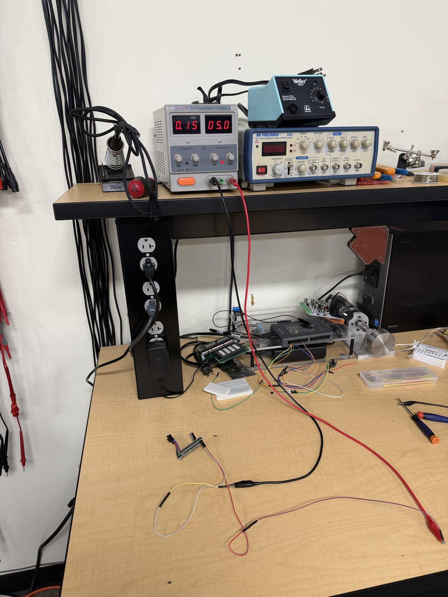

*April 2, 2026: Lab bench used for bring-up: bench power supply and function generator.*

## Perfboards (my design)

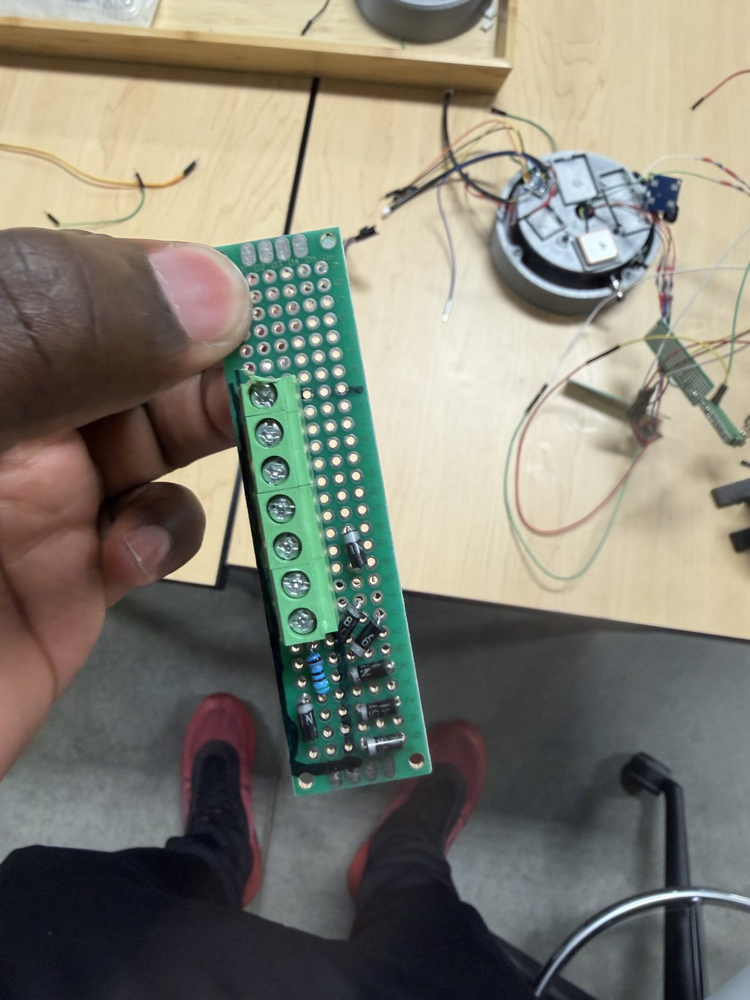

*April 9, 2026: First perfboard strip with screw terminals.*

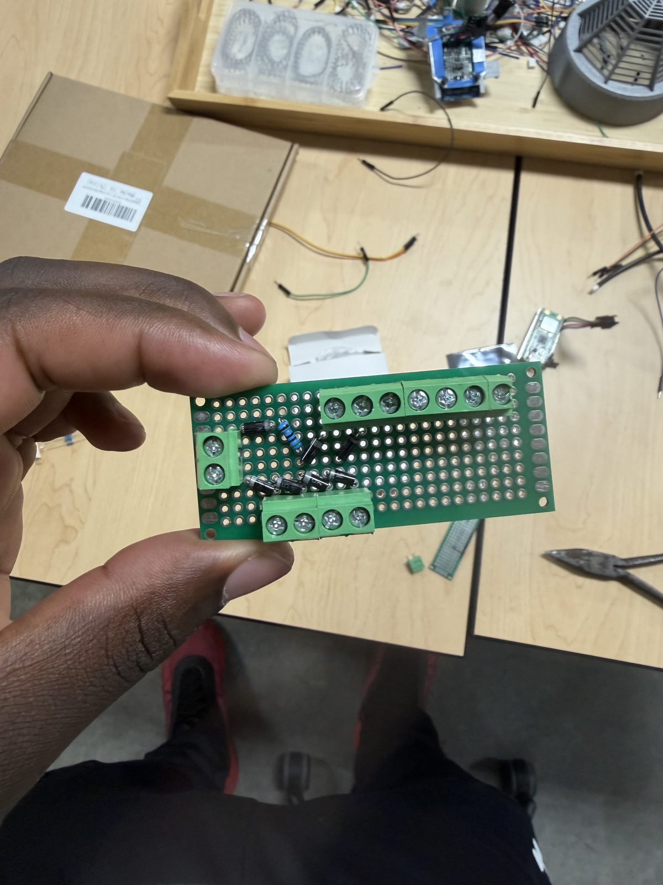

*April 9, 2026: First perfboard revision, screw terminals fitted.*

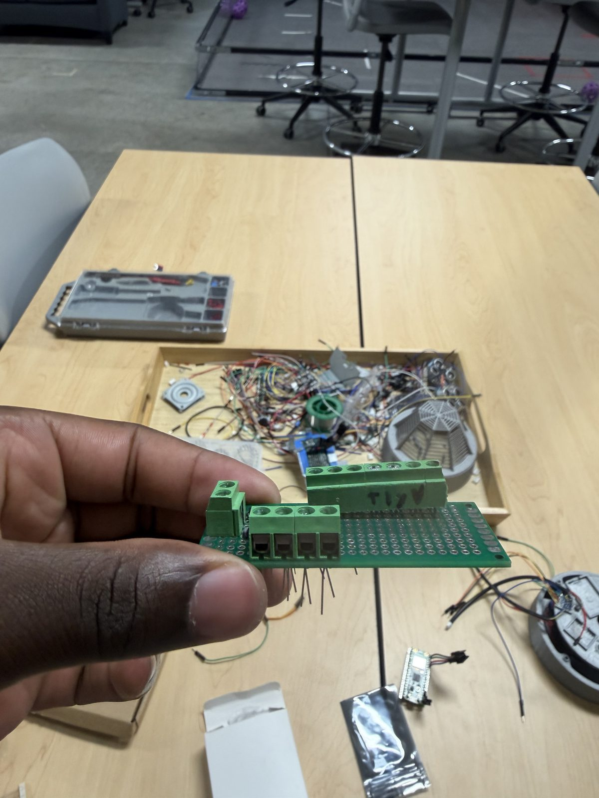

*April 9, 2026: First perfboard revision, top view.*

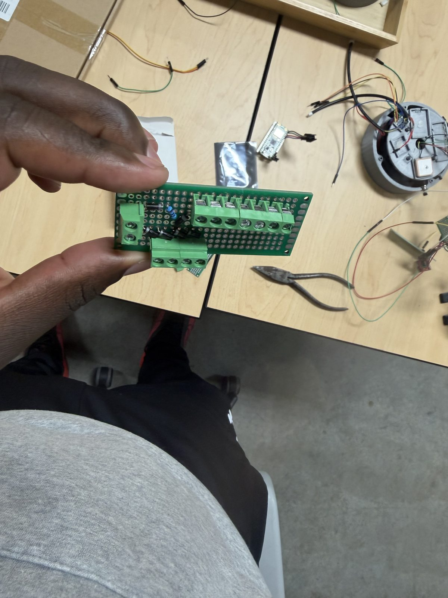

*April 9, 2026: First perfboard revision, terminal rows.*

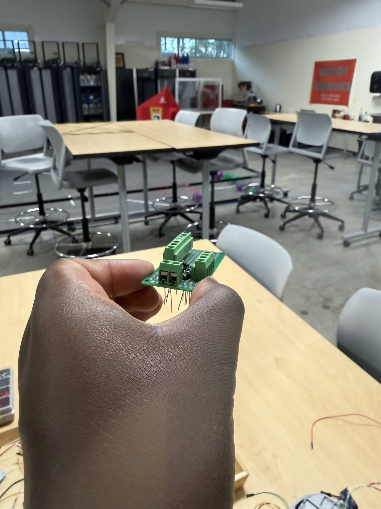

*April 9, 2026: Small perfboard with screw terminals and headers.*

*April 21, 2026: Second perfboard revision: compact board with diodes, resistor and screw terminals.*

## Wiring harness

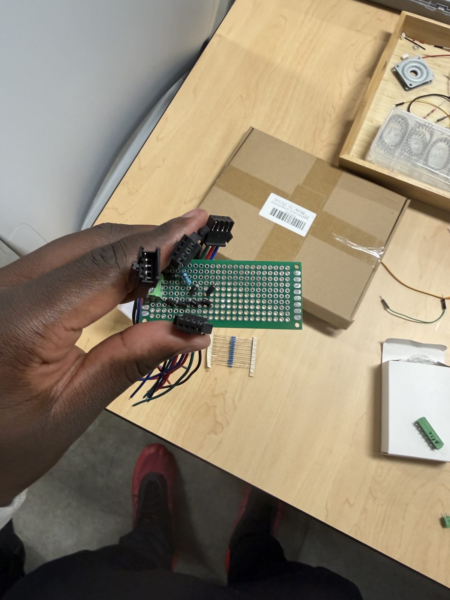

*April 9, 2026: Perfboard with JST connectors and the start of the harness.*

*April 9, 2026: JST wiring harness assembly.*

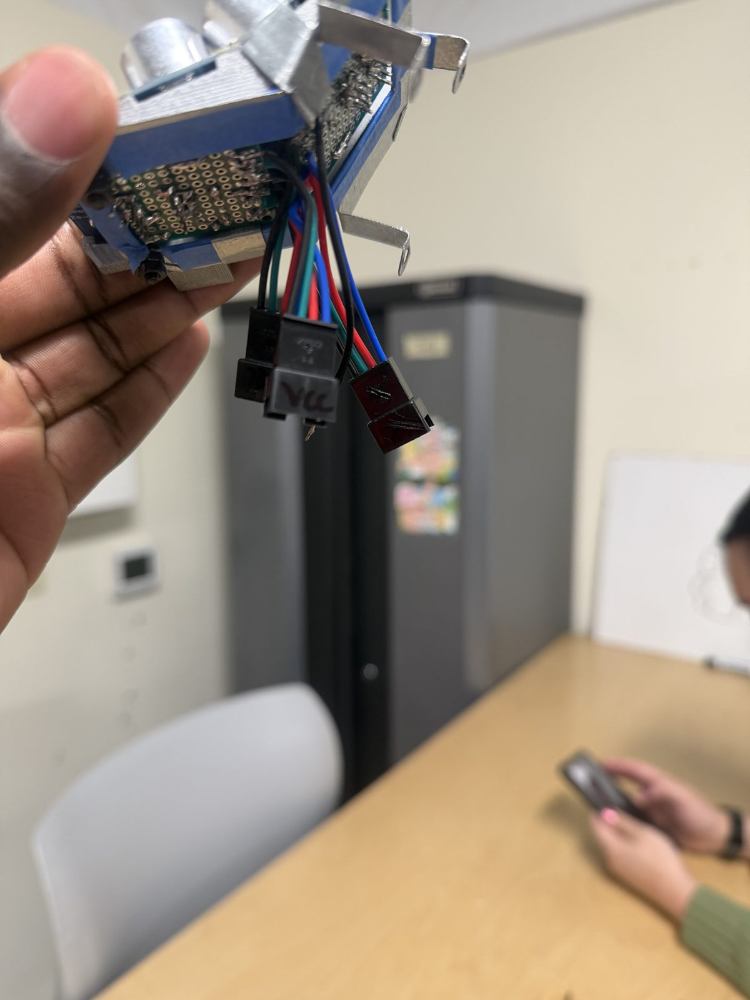

*April 7, 2026: Sensor bracket with its harness and JST plugs.*

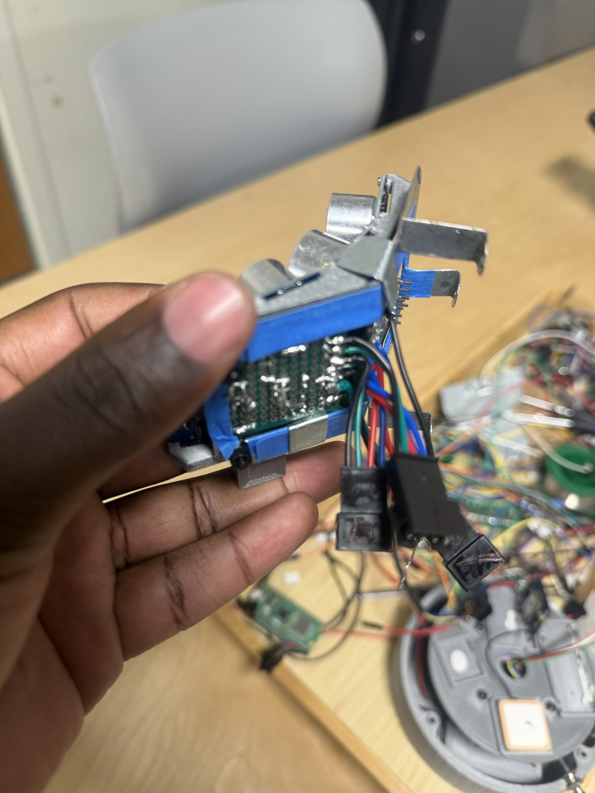

*April 7, 2026: Sensor bracket wired into the electronics stack.*

## Bench bring-up

*April 9, 2026: Pico on jumper wires driving the sensors before integration.*

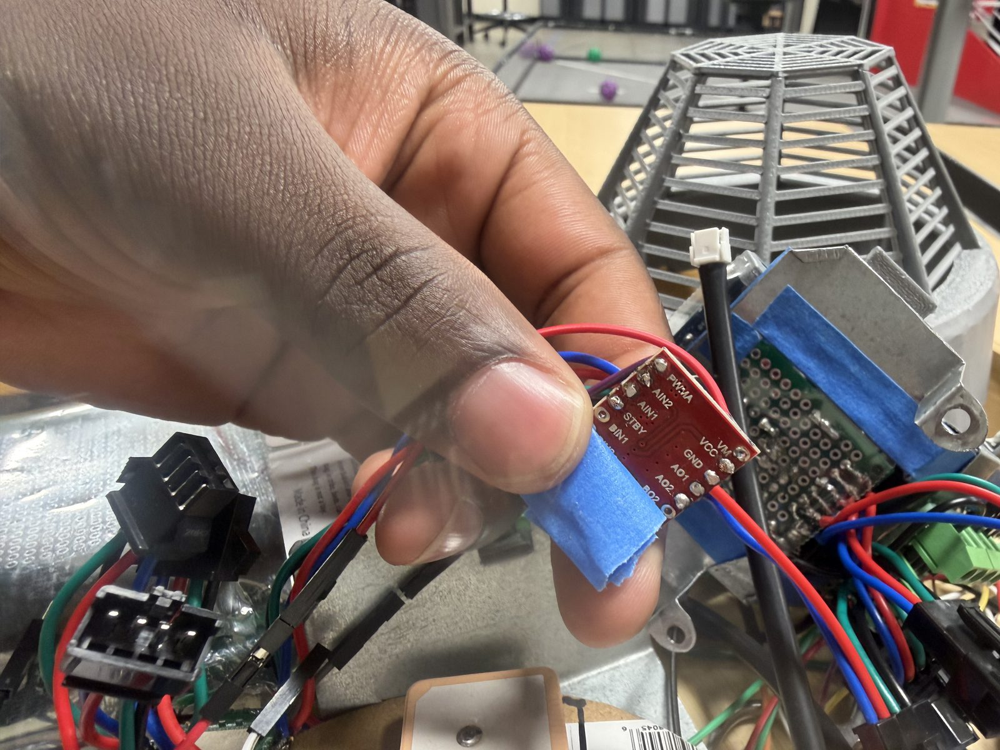

*April 14, 2026: TB6612FNG motor driver and harness during testing.*

## Electronics plate

*April 14, 2026: Electronics plate: GPS, motor driver and level shifter on JST harnesses.*

*April 21, 2026: Electronics plate with the GPS patch antenna, top view.*

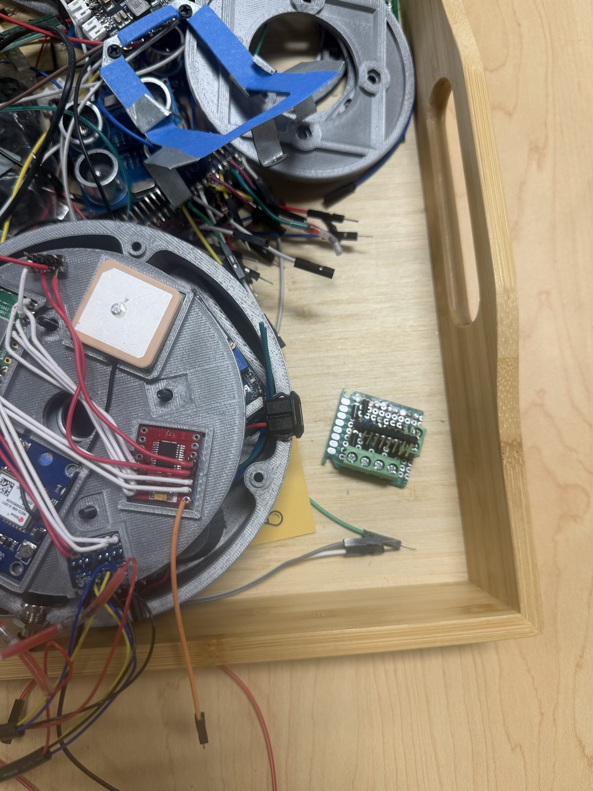

*April 21, 2026: Electronics plate in the parts tray beside the second perfboard revision.*

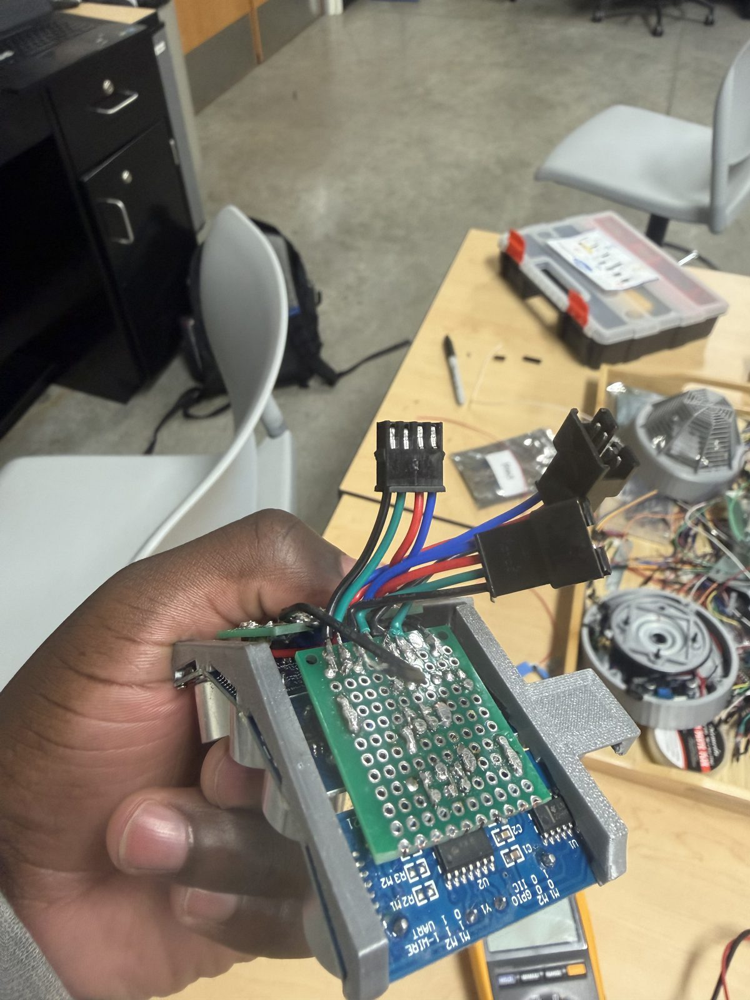

*April 21, 2026: Sensor head with the perfboard mounted in its bracket.*

## Assembled scanner

*April 14, 2026: Fully wired unit on the bench with multimeter checks.*

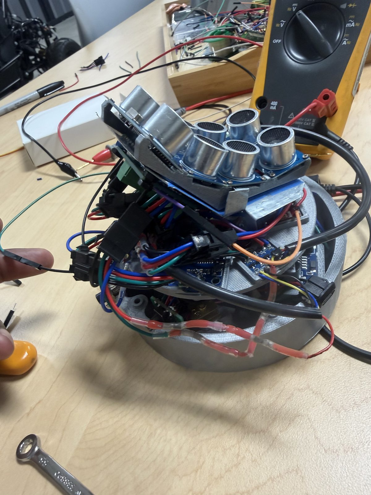

*April 14, 2026: Fully wired unit with the ultrasonic array on the sensor head.*

*April 27, 2026: Assembled scanner, top view of the ultrasonic array.*

*April 27, 2026: Assembled scanner, side view.*

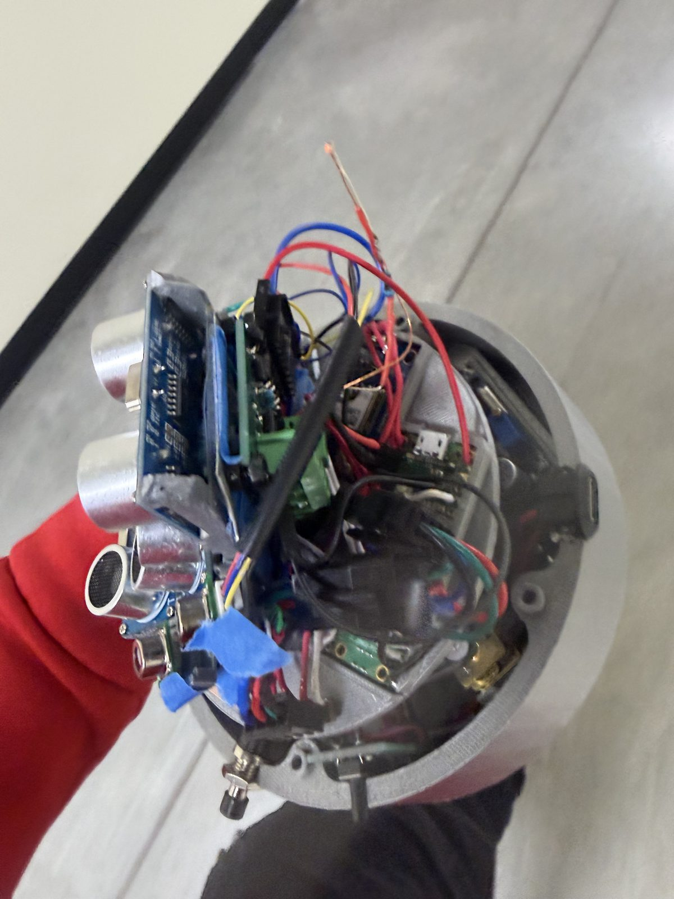

*April 27, 2026: Assembled scanner, angled view.*
